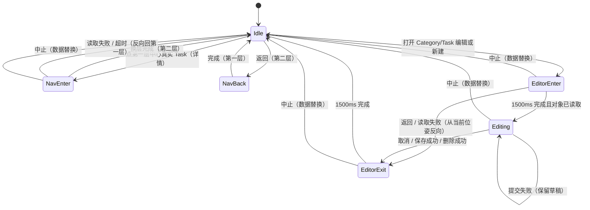

# 阶段 2：Rhine 界面与动效重构

前置：[总览](README.md)第 2 节的源码发现、决策 D2–D5，以及[阶段 1](01-全局液态玻璃设计系统.md)的材质与动效令牌。本阶段不改变 Rhine 的业务规则：两层结构、0 号块含义、有限边界、尾插、删除定位、排序与搜索都不变，见 [修改文档](../修改文档.md) 与 [创建Rhine](../创建Rhine/README.md)。

## 1. 删除右侧信息区与底部工具栏

### 1.1 现有右侧信息区清单（逐项核对源码）

| 元素 | 源码 | 作用 | 新位置 |
| --- | --- | --- | --- |
| `←` 返回类别层（仅第二层） | `RhineScreen.kt:1398`（窄屏 `1250`） | `returnToParent()` | 工具栏 A 组首位，图标 + “返回” |
| 路径 `父 Task / CATEGORY nn / 名称` | `1407–1415` | 只读 | 焦点胶囊第二行（截断）；当前列名称已在工具栏 V 切换中显示 |
| 焦点标题（序号 + 标题，文字色） | `1418–1428` | 只读 | 焦点胶囊第一行，粗体，保留 `style.readable(titleColor)` |
| 圆点与通到右缘的细线 | `1430–1434` | 装饰 | 删除 |
| 状态（完成 / 0 号项数 / 空位置说明） | `1437` | 只读 | 焦点胶囊第二行 |
| `DATE` 完成日期 | `1439–1442` | 只读 | 焦点胶囊第二行末尾 |
| 模式操作按钮：编辑 Category/Task、进入 Section 层、编辑 Section、新建、尾部新增、移动到第 N 项 | `1445–1482`（窄屏 `1274–1293`） | `onAction` → `activate(焦点槽位)` / 序号输入 | 工具栏 D 组主按钮（着色玻璃），文字与启用条件逐字沿用 |
| 预览模式提示 | `1446–1447` | 提示 | 删除；切换模式时顶部临时信息已显示同样文字（`735–740`） |
| 删除按钮（`0.80W, 0.68H`） | `1485–1494`（窄屏 `1294–1295`） | `requestDelete()` | 工具栏 D 组末位，危险样式 |

同时并入工具栏、原本在底部的元素：U 步进与刻度条（`1517–1543`）、V 切换（`1556–1594`）。刻度下方的提示行（`1544–1553`）因位置被工具栏占用而删除，理由同“预览模式提示”。

保留不动：左上品牌块、右上控件行（SEARCH / 模式 / ⇤）、左下沿列读数、右下 DONE、页脚（数据量与 `TASK ↗` / `SETTING ↗`）、顶部临时信息（`notice` / `loading` / 排序保存中）。其中读数、DONE 和页脚只调整与工具栏的垂直间距。

回调 `onBack`、`onAction`、`onDelete`、`onStepU`、`onStepV` 的签名和调用目标都不变，只是改由工具栏调用。删除焦点信息区后不留下未使用的参数或分支（编译警告与代码检查确认）。

### 1.2 工具栏布局

**宽屏**（`w ≥ 700dp`、`h ≥ 340dp`、字号 ≤ 1.35，即现有宽屏条件）：

```text
┌───────────────────────────────────────────────────────────────────────────────────────────┐
│ Grhinet                                                   ⌕ SEARCH    + DETAIL    ⇤       │
│ CATEGORY LAYER                       ╭ 详情 · 编辑、新增或删除 ╮   ← 顶部临时信息（保留）  │
│ MODE DETAIL                          ╰───────────────────────╯                            │
│                     （场景：中心墙锚点 0.34W, 0.60H，不移动）                               │
│ TASK                                                                                      │
│ 03 / 08                                                                    DONE 02/08 ▬   │
│ ╭─A──────┬─B────────────┬─C───────────────────┬─焦点胶囊────────────────┬─D─────────────────╮ │
│ │ ← 返回 │ ↑ ┆┆┆┃┆┆┆ ↓ │ ‹ CATEGORY 02/05 工作 › │ 03  迁移数据库           │ 编辑 Category → │ 删除 │ │
│ │        │              │                     │ ○ 未完成 · DATE —       │                 │      │ │
│ ╰────────┴──────────────┴─────────────────────┴─────────────────────────┴─────────────────╯ │
│ 05 CATEGORIES · 42 TASKS                                              TASK ↗  /  SETTING ↗ │
└───────────────────────────────────────────────────────────────────────────────────────────┘
```

- 容器：`GlassToolbar`，`Thin` 档，采样 Rhine 画布做背景模糊；高 52dp，圆角 22dp；左右边距 0.03W，最大宽 980dp，居中。
- 分组以 0.5dp 细线分隔；焦点胶囊占剩余宽度（`weight(1f)`），两行文字均单行省略。
- 第一层不显示 A 组。预览模式不显示 D 组的主按钮，焦点胶囊加宽。调整模式下主按钮为“移动到第 N 项”，不显示删除。
- 拖动排序时（`adjustment.dragging`）工具栏整体淡到 0.4 且不可点，与现有 `enabled = !blocked` 一致。

**窄屏**（宽屏条件不满足）：去掉右侧 49% 宽的滚动列（`RhineScreen.kt:1243–1298`）。工具栏为单行 48dp，A–D 组可横向滚动，焦点胶囊最小宽 160dp。现有窄屏底行中，`DONE x/y` 并入焦点胶囊第二行，`TASK ↗` / `SETTING ↗` 移到右上控件行，腾出底部高度。

### 1.3 不遮挡规则

焦点块地面投影的最低点：

```text
y_low = anchor.y·H + (L/2)·|eV.y| + (D/2)·|eU.y|      （L 块长、D 块深，均为当前几何的 px）
```

工具栏顶边必须 ≥ `y_low + 8dp`。默认密度下块长随屏宽缩放（`RhineDisplay.kt:8`），计算结果：914×411dp 为 299 对 327dp，800×360dp 为 262 对 277dp，731×329dp（窄屏）为 240 对 265dp，余量都 ≥ 15dp。若用户的自定义几何（块长 360dp 等）使条件不成立，工具栏改为 40dp 的“低矮模式”（只保留图标与焦点标题），**不移动场景锚点**，以免改变阶段 01 已确认的构图。规则写成纯函数 `rhineToolbarProfile(geometry, viewport, insets)` 并做单元测试。

Rhine 锁定横屏（阶段 01 的用户决定），“不同方向”在这里指不同长宽比（16:9–21:9）、分屏/小窗、刘海与系统手势区；工具栏使用 `rhineSafeDrawingInsets()`。

## 2. 对话框与浮层

操作语义、按钮文字、校验、`saving` 防重复与错误保留全部沿用。只改容器与样式；能放进主窗口的浮层改为窗口内覆盖层，以便模糊场景。

| 现有 | 源码 | 新形式 | 档位 |
| --- | --- | --- | --- |
| Category / Task 编辑器 `RhineEditor`（右侧 68% `Dialog`） | `RhineEditor.kt:67` | 分屏编辑器（第 7 节），窗口内覆盖层 | Thick |
| Section 编辑器 `SectionEditor(wide = true)` | `RhineEditor.kt:52` | 保留现有布局与流程（D5），容器换为 `GlassDialog` | Thick |
| 删除确认 `AlertDialog` | `RhineScreen.kt:860` | `GlassAlertDialog`；确认按钮为危险着色；文案不变 | Thick |
| 序号输入 `RhinePositionPanel` | `RhineSearch.kt:140` | 窗口内覆盖层，靠右，宽 `min(420dp, 0.46W)`，保留固定操作行与键盘下的紧凑模式 | Regular |
| 搜索 `RhineSearchPanel` | `RhineSearch.kt:47` | 同上，宽 `min(520dp, 0.52W)`；结果行为 `Content` 胶囊 | Regular |
| 拖动状态条（整列/内容、`n → m`、取消移动） | `RhineScreen.kt:773` | `GlassToast` 样式胶囊，取消为按钮 | Thin |
| 顶部临时信息、载入详情、正在保存排序 | `RhineScreen.kt:817–834` | `GlassToast`；位置、3 秒计时、文字不变 | Thin |

窗口内覆盖层的统一外壳 `RhineOverlay`：拦截底层手势（全屏透明点击层，点外部等同原 `onDismissRequest`）、`DraftBackHandler` 处理返回、`imePadding()` 与 `rhineSafeDrawingInsets()`，并在出现和消失时淡入淡出 + 平移 24dp（150ms）。

## 3. Category → Task 导航动画（约 1.0 秒）

触发：详情模式下，点中心列的真实 Task（第一层），即现有 `activate()` 的进入分支（`RhineScreen.kt:484`）。

### 3.1 时间线

```text
时间 ms        0    100   200   300   400   500   600   700   800   900   1000
抬升 Δz        ████████████████████████████████████████░          EaseOutCubic   0→650
相机偏航       ███████████████████████████████████████████        EaseInOutCubic 0→700
缩放 1→1.06    ███████████████████████████████████████████        EaseInOutCubic 0→700
HUD/工具栏     ██▓░                                                淡出 0→150
场景淡出                            ▓▓▓▓▓▓▓▓▓▓▓▓▓▓▓▓                EaseExit 450→700
换层（数据就绪）                                     ▲ 700
第二层淡入                                           ░░▒▒▓▓▓▓▓████  EaseStandard 700→1000
HUD/工具栏                                                     ░▓██ 淡入 850→1000
```

- 选中块抬升 `Δz_nav = 0.80·H`（`H = baseHeight + centerLift + peakLift`，默认 110dp，即约 88dp），远高于现有整屏上移 8dp。
- 相机以选中块中心为枢轴，逆时针（俯视）偏航到 `ψ_nav = 0.5·ψ_E ≈ 23.8°`（`ψ_E` 见 5.3）。相机竖直跟随 30% 的抬升，使块在屏幕上上升约 `0.7·Δz_nav`，同时不超出顶部安全区。
- 抬升与偏航同时开始：抬升先到位（650ms），偏航在 700ms 结束，二者同步但不同步结束，读起来更像“被托起后转向”。
- 淡出与运动重叠 250ms（450–700ms），转动在画面变淡的过程中完成，避免“停住再淡”。淡出目标是地面色 `style.floor`，不是黑色。
- **数据预取**：点按时立即开始读取 Task 摘要与计数（现有代码在淡出之后才读）。700ms 时若数据未就绪，保持淡出状态等待；超过 300ms 显示“载入…”胶囊，5 秒超时或对象已不存在时，以 300ms 反向淡入回第一层恒等位姿，并提示（沿用 `returnToParent()` 的回退语义）。
- 换层时第二层以默认位姿（恒等）出现，第一层的位姿和抬升被清除，`session.parent` 快照与 `session.position` 记忆照旧。

### 3.2 返回（Task → Category）

保持现有 180ms + 180ms 的整屏缩放淡出淡入（`RhineScreen.kt:405–417`），不加抬升与旋转。只把它纳入第 8 节的状态机（`NavBack`），保证不与其他动画并发。

## 4. 编辑器进入（约 1.5 秒）

触发：详情模式下，中心列稳定时点 0 号块（编辑 Category / Task）、占位块（第一层新增 Task）或新增列（新增 Category / 兄弟 Task），以及工具栏主按钮。Section（第二层真实块与占位块）不走此流程（D5）。

### 4.1 三个步骤

**步骤 1：大幅抬升（0–550ms）**。选中块整体上浮 `Δz_edit = H + 12dp`（默认 122dp），离开地面。阈值保证块的底面高于场景中任何块的顶面，抬升完成后不再被任何块遮挡（证明见 5.4）。相机竖直跟随 45%，块在屏幕上上升约 `0.55·Δz_edit`，并按顶部安全区限幅。

**步骤 2：相机逆时针旋转（550–1150ms）**。块到达最高点后，相机绕块中心偏航到 `ψ_edit`，同时把俯仰系数调到编辑值、缩放到编辑构图，并把块平移到左半屏预览区中心。终点位姿（D4 推荐）：

| 参数 | 值 | 效果 |
| --- | --- | --- |
| 偏航 `ψ_edit` | `0.8·ψ_E ≈ 38.1°` | 正面基本朝向相机，仍露出一线端面 |
| 俯仰系数 `k_h`（水平分量的屏幕纵向缩放） | 1.30 | 视线更俯，顶面更清楚 |
| 竖直系数 `k_z` | 0.96 | 抵消俯视后侧面显得过高 |
| 缩放 `s_edit` | 按预览区计算（5.5），默认 914×411dp 屏约 1.3 | 块宽约占预览区 78% |

结果：同时看到顶面（序号与标题）、正面（Category / Task 名称与插图）和一线端面，不是把视角压成正视。

**步骤 3：淡出淡入（1100–1500ms）**。周围的块（上下文层）1100–1350ms 淡出到地面色，编辑面板 1250–1500ms 淡入并从右侧平移 32dp 到位，两者交叉 100ms。

**为什么选中块不参与淡出**：编辑器左侧预览就是同一个场景画布、同一个终点位姿，块在过渡中一直连续绘制，因此场景与编辑器之间不会跳变。淡出淡入只作用于上下文块、HUD 和编辑面板。若用户希望连块也一起闪过，可改为整屏交叉淡化，但会产生一帧的位置不连续，不推荐。

### 4.2 时间线

```text
时间 ms         0    150   300   450   600   750   900  1050  1200  1350  1500
HUD/工具栏淡出  ███▓░                                                           0→150
抬升 Δz         ████████████████████▌                                           EaseOutCubic 0→550
偏航/俯仰/缩放                       ▐██████████████████████▌                   EaseInOutCubic 550→1150
平移到预览区                         ▐██████████████████████▌                   EaseInOutCubic 550→1150
上下文淡出                                                ▐▓▓▓▓▓▓▓▓▌            EaseExit 1100→1350
编辑面板淡入                                                     ▐░▒▓▓██████▌   EaseStandard 1250→1500
对象读取        ▓▓▓▓（与动画并行，`loading`）
```

对象读取（`activate()` 中的 `repo.getCategories()` / `getTaskById()`）在点按时就开始，与步骤 1 并行。面板淡入前若读取未完成，面板等待；读取失败时以退出动画（取消）返回并显示错误，与现有 `notice` 文案一致。

### 4.3 新建时的块

| 来源 | 预览块 | 标签变化 |
| --- | --- | --- |
| 第一层 0 号块（编辑 Category） | 原块 | 无 |
| 第二层 0 号块（编辑 Task） | 原块 | 无 |
| 第一层新增列（新建 Category） | 新增列 u=0 槽位的块 | 步骤 1 中，“+ 新建 Category”在 300ms 内交叉淡化为草稿名称（为空时显示“未命名”） |
| 第二层新增列（新建兄弟 Task） | 同上 | 同上 |
| 第一层中心列占位（新建 Task） | 该占位块 | 正面由 Category 名称（或空白）淡化为草稿 Task 标题 |

编辑期间预览块使用“自身标签”：正面显示被编辑对象自己的名称，顶面显示 `00 ✎ 名称`（与现有 0 号块一致）。草稿的标题、文字颜色、插图实时同步到预览：给 `CategoryUpsertSheet`、`TaskUpsertSheet` 增加可选参数 `onDraftChange: ((T) -> Unit)? = null`，在内部状态变化时回调（`snapshotFlow` + `distinctUntilChanged`），其他调用处不受影响。

## 5. 相机坐标系与位姿

### 5.1 现有约定（源码）

- 世界坐标 px：U 沿列（0 为列首），V 跨列，Z 向上。槽位 `(u, v)` 占 `U∈[u·pitchU, u·pitchU+D]`，`V∈[v·pitchV, v·pitchV+L]`（`RhineGeometry.kt:86`）。
- 屏幕：`p_s = anchor + (wu−camU)·eU + (wv−camV)·eV + z·eZ`，`eU=(−0.959,−0.282)`、`eV=(0.875,−0.485)`、`eZ=(0,−1)`，`anchor=(0.34W, 0.60H)`。
- u=0 在每列的最右下方（`eU.x < 0`，u 增大时向左），因此 0 号块是“每列最右侧的块”。阶段 3 的图片可见规则依赖这一点，已由投影公式核对。
- 视线方向（世界中与屏幕点重合的方向）由 `B·d = 0` 求得：`d ∝ (slopeU, slopeV, −1) = (1.229, 1.347, −1)`，水平方位为从 +U 向 +V 转 `ψ_E = atan2(1.347, 1.229) = 47.62°`。

### 5.2 位姿

新增 `RhinePose`（`rhine/RhinePose.kt`），只描述相机，不描述块：

```kotlin
@Immutable data class RhinePose(
    val yaw: Float = 0f,            // 弧度，绕世界 Z 轴
    val kh: Float = 1f,             // 水平分量的屏幕纵向系数（俯仰）
    val kz: Float = 1f,             // 竖直分量系数
    val zoom: Float = 1f,
    val pivot: WorldPoint? = null,  // null 表示 (camU, camV, 0)
    val screen: Offset? = null,     // null 表示 anchor
)
```

投影推广为：

```text
B_k = | eU.x       eV.x       eZ.x      |      Rz(ψ) = | cosψ  −sinψ  0 |
      | kh·eU.y    kh·eV.y    kz·eZ.y   |              | sinψ   cosψ  0 |
                                                        |  0      0    1 |
p_s = screen + zoom · B_k · Rz(ψ) · (p − pivot)
```

- **恒等**：`ψ=0, kh=kz=zoom=1, pivot=(camU,camV,0), screen=anchor` 时与现有公式逐项相同。实现中 `RhinePose.Identity` 走原代码路径，不经过三角函数，保证默认画面按位相同。
- `unproject`：同一个 2×2 线性方程组，`det` 改用 `B_k·Rz` 的前两列计算。命中、可见窗口（`visibleSlots`）、手势分解都改为调用推广后的 `project` / `unproject`。非恒等位姿只出现在过渡与编辑期间，此时输入已被阻塞。
- `FaceFrame` 由投影差分得到（`RhineScene.kt:302–337`），自动带上旋转与缩放，贴面文字和插图无需另写变换。
- 位姿插值：`lerp(start, end, e(t))`，每帧由起点、终点和进度直接计算。终点帧直接赋值终点位姿；返回默认时赋值 `Identity`，不累加增量，不残留浮点误差。

### 5.3 旋转方向与可行区间

偏航后的视线为 `d' = Rz(−ψ)·d`，其水平方位为 `47.62° − ψ`。脚本核对：

| ψ | 屏幕上 U 轴 | 屏幕上 V 轴（与水平夹角） | 视线 U 分量 | 视线 V 分量 |
| --- | --- | --- | --- | --- |
| 0° | (−0.959, −0.282) | 29.0° | +1.229 | +1.347 |
| 12° | (−0.756, −0.377) | 21.5° | +1.482 | +1.062 |
| 23.8°（导航） | (−0.524, −0.454) | 15.5° | +1.668 | +0.736 |
| 38.1°（编辑） | (−0.215, −0.521) | 9.2° | +1.799 | +0.302 |
| 47.6°（`ψ_E`） | (0, −0.548) | 5.2° | +1.824 | 0 |

- 当 `ψ ∈ [0, ψ_E]` 时，视线的 U、V 分量都 ≥ 0，所以现有画家序（u 降序、v 降序）仍然正确，`cap`（v0 端面）始终朝向相机或刚好侧对。现有三面绘制无需增加 v1 端面。
- 反方向（ψ < 0）会让 V 分量更大，正面越来越斜，无法“正对”正面；ψ > ψ_E 会露出未绘制的 v1 端面并破坏画家序。所以 `[0, ψ_E]` 是唯一可行区间。
- **方向命名**：俯视时 U→V 为顺时针（屏幕 y 向上时 `U×V = −0.712`），因此正 ψ 是场景在屏幕上顺时针转动，等价于相机俯视逆时针绕行。这就是“进入逆时针、退出顺时针”（D3）。
- 俯仰系数 `kh` 只缩放纵向分量，不改变视线的水平方位（`B_k` 第一行不变），画家序不受影响。

### 5.4 抬升块的几何与绘制次序

- `RhineProjection.block()` 增加 `z0` 参数（块底高度，默认 0），四个面的底边从 `z0` 开始，接触阴影仍投在 `z=0` 的槽位上，随抬升扩大并变淡（`alpha × (1 − 0.6·Δz/(Δz_edit))`）。
- **不被遮挡的条件**：从块上任一点射向观察者的方向为 `−d'`，Z 分量严格为正。若 `z0 > maxHeight`，射线上的点都高于场景中任何块的顶面，因此不会被挡住。抬升完成后（`Δz ≥ H + ε`），选中块可以从画家序中取出，最后绘制。
- 抬升过程中（`Δz < H`），选中块仍按画家序绘制，与相邻块的遮挡关系照常。
- 上下文淡出只在选中块已取出后进行：上下文块画进单独的图层，整体乘透明度，避免逐面半透明造成的重叠伪影。退出时同理，降到 `H` 以下之前上下文已完全不透明，切回画家序在视觉上不可见。

### 5.5 编辑构图

预览区 `R` = 屏幕左侧（宽见 7.2）扣除安全区与 16dp 内边距。把选中块（含抬升）的 8 个角点在 `zoom=1` 的终点位姿下投影，得到包围盒尺寸 `(bw, bh)`：

```text
s_edit = min(0.78·R.w / bw, 0.62·R.h / bh)，限制在 [0.6, 2.4]
screen = R.center
```

默认几何下的估算：914×411dp 屏为 1.32，800×360dp 为 1.16，731×329dp 为 1.06。键盘弹出导致 `R` 变化时，用 200ms `EaseStandard` 过渡到新的 `s_edit` 与 `screen`，同样是确定性的重新取目标。

### 5.6 位姿测试（第二期必须先过）

- 恒等位姿下，随机 1 万个世界点的 `project` 结果与旧实现完全相等（`assertEquals`，不用容差）。
- 任意位姿下 `unproject(project(p)) ≈ p`（误差 < 1e-3 px）。
- `ψ ∈ [0, ψ_E]` 抽样时，视线 U、V 分量 ≥ 0；`ψ_edit`、`ψ_nav` 由几何计算，不写死角度。
- 抬升 `Δz ≥ H + ε` 时，选中块的屏幕多边形与所有上下文块的命中测试互不遮挡。
- 退出动画终点帧的位姿 `== RhinePose.Identity`，浏览器相机等于目标快照相机。

## 6. 计时与缓动

全部取自 `GritMotion`（阶段 1 第 3.1 节），集中在 `RhineMotionSpec`：

| 过渡 | 总时长 | 组成 |
| --- | --- | --- |
| 进入 Task（导航） | 1000ms | 抬升 0–650、偏航 0–700、淡出 450–700、换层 700、淡入 700–1000 |
| 返回 Category | 360ms | 现有 180 + 180 |
| 编辑器进入 | 1500ms | 抬升 0–550、旋转 550–1150、上下文淡出 1100–1350、面板淡入 1250–1500 |
| 编辑器退出 | 1500ms | 面板淡出 0–250、上下文淡入 200–500、下落与顺时针回转 500–1500、HUD 淡入 1350–1500 |
| 删除退出 | 1500ms | 面板淡出 0–250、块溶解 250–600、相机回转 600–1500 |
| 减少动效 | 0 | 全部位移、旋转、淡化为 0（与现有一致），状态顺序不变 |

## 7. 编辑布局

### 7.1 结构

```text
┌──────────────────────────────┬────────────────────────────────┐
│                              │ ╭ 编辑 Category ─── 保存  ✕ ─╮ │ ← 固定操作行（沿用 pinnedActions）
│                              │ │ 错误提示（保留草稿）        │ │
│     ╱▔▔▔▔▔▔▔▔▔▔▔▔▔▔╲         │ │ 插图  [缩略图] 选择 / 移除   │ │ ← 阶段 3
│    ╱ 00 ✎ 工作       ╲        │ │ 名称 ________________       │ │
│   ▕▔▔▔▔▔▔▔▔▔▔▔▔▔▔▔▔▔▔▏       │ │ 描述 ________________       │ │
│   ▕ 02  工作          ▏       │ │ 文字颜色 ● ● ● ○            │ │
│   ▕ ┌──────────────┐  ▏       │ │ …（现有表单内容，滚动）       │ │
│   ▕ │   插图        │  ▏       │ │                             │ │
│   ▕ └──────────────┘  ▏       │ │ 删除当前对象（危险）          │ │
│    ▔▔▔▔▔▔▔▔▔▔▔▔▔▔▔▔▔▔        │ ╰────────────────────────────╯ │
│   左：场景画布（编辑位姿）       │ 右：Thick 玻璃面板（窗口内）      │
└──────────────────────────────┴────────────────────────────────┘
```

- 左侧不是另一块画布：仍是全屏 `RhineCanvas`，编辑位姿把选中块放在左半区中心，上下文透明度为 0，因此无跳变。
- 右侧面板容纳现有 `CategoryUpsertSheet(fullScreen = true, pinnedActions = true)` / `TaskUpsertSheet(fullScreen = true, restrictStructure = true, …)` 的全部字段、校验、未保存提示和 `saving` 状态；“删除当前对象”保留在原位置语义，改为危险样式。
- 编辑器从 `Dialog` 改为窗口内覆盖层（`RhineOverlay`）：返回键由 `DraftBackHandler` 处理（未保存提示沿用表单内部逻辑），键盘用 `imePadding()`。

### 7.2 响应式

| 条件 | 面板宽 | 预览区 |
| --- | --- | --- |
| `W ≥ 840dp` | 50% | 左 50% |
| `640 ≤ W < 840dp` | 52%，最小 360dp | 其余 |
| `W < 640dp`、分屏或字号 > 1.35 | 58%，最小 340dp | 其余；若预览区宽 < 220dp，块缩小到左上 30%（`s_edit` 下限 0.6），仍可见 |
| 键盘弹出 | 不变 | 预览区为键盘以上部分，按 5.5 重新取目标；可用高度 < 140dp 时块淡出到 0，收起键盘后淡入 |

触控与键盘：面板内所有控件保留现有焦点顺序、`imeAction` 与可访问性描述；预览区不可交互（触摸被覆盖层拦截），不会误触场景。

## 8. 编辑器退出（约 1.5 秒）

### 8.1 顺序

1. 0–250ms：编辑面板淡出并右移 32dp。
2. 200–500ms：上下文块淡入，露出仍处于抬升、旋转状态的块（编辑位姿）。
3. 500–1500ms：块下落 `Δz → 0`，同时相机顺时针回转 `ψ → 0`，`kh、kz、zoom → 1`，平移回默认构图。二者同一缓动 `EaseInOutCubic`，同步开始、同步结束。
4. 1350–1500ms：HUD 与工具栏淡入。
5. 1500ms：赋值 `RhinePose.Identity`，清除抬升，浏览器相机设为目标快照；之后恢复输入。

### 8.2 退出目标

| 原因 | 目标相机 | 选中块 |
| --- | --- | --- |
| 取消、关闭、保存已有对象 | 进入前的快照（`browser.snapshot()`，按新边界 `clamp`） | 落回原槽位 |
| 保存新建对象 | `submit()` 已得到的 `createdSnapshot` 相机 | 下落时世界位置从原槽位插值到新对象槽位（例如 U=99 的占位新增到第 2 项），落下即成为真实块 |
| 删除（编辑器内删除 → 确认 → 成功） | `deletedSnapshot` 相机 | 先溶解（透明度与 0.96 缩放），再回转相机 |
| 已提交但定位失败 | 进入前快照按新边界 `clamp` | 落回；显示现有“数据已保存；定位已刷新”提示 |
| 提交失败（未提交） | 不退出 | 留在编辑态，错误与草稿保留（现有行为） |

现有 `submit()` 中保存成功后的 `targetBrowser.animateTo(snapshot.camera)` 由退出动画取代：只移动一次，不再叠加 240ms 的二次移动。

## 9. 状态机与中断处理

新增 `RhineDirector`（`rhine/RhineDirector.kt`），是 Rhine 过渡的唯一所有者：持有一个 `Job`、一个递增的 `epoch`，以及当前 `RhineStage`。`RhineScreen` 中的 `transition`、`transitionJob`、`phase`、`epoch` 迁入其中。



| 事件 | Idle | NavEnter | NavBack | EditorEnter | Editing | EditorExit |
| --- | --- | --- | --- | --- | --- | --- |
| 场景点按 / 工具栏操作 | 处理 | 忽略 | 忽略 | 忽略 | 不可达（覆盖层拦截） | 忽略 |
| 返回键 | 现有逻辑 | 消费并忽略（≤1s 后完成） | 消费 | 反向退出，时长 `max(400, 1500·进度)` ms | 交给表单（未保存提示） | 消费 |
| 视口 / 字号 / 显示设置变化 | 现有逻辑 | 数据已就绪则直接完成换层，否则取消回第一层 | 直接完成 | 直接跳到 Editing，按新视口重算编辑位姿 | 重算编辑位姿（无动画） | 直接跳到终点 |
| 数据代际变化（导入替换） | 现有逻辑 | 中止 → Idle 恒等 | 同左 | 同左并关闭编辑 | 同左（现有行为：`edit = null`） | 同左 |
| 生命周期停止 / 页面离开 | — | 协程随组合取消；返回时 `Idle`（恒等位姿） | 同左 | 同左 | 同左 | 同左 |

工程约束：

- 新过渡开始前取消旧 `Job` 并递增 `epoch`；回调里先校验 `epoch`，过期回调直接丢弃（沿用现有模式）。
- 动画只用 `Animatable` / `withFrameNanos`，不注册监听器；`DisposableEffect` 在离开时把阶段重置为 `Idle` 并清除抬升，避免泄漏和残留回调。
- `blocked` 增加 `director.stage != Idle` 条件，杜绝快速连点并发；`browser.stop()` 在过渡开始时调用。
- 进程重建：位姿与阶段不保存（遵循 `RhineSession` “不存像素坐标”的原则），重建后为 `Idle` 恒等位姿，与现有编辑器在进程死亡后关闭的行为一致。
- 导航历史：`session.parent`、`categoryId`、`showingSections`、`position` 的读写时机与现在相同；第 3 节只改变视觉，不改变这些状态的顺序。

## 10. 代码改动范围

| 文件 | 改动 |
| --- | --- |
| `rhine/RhinePose.kt`（新） | 位姿、插值、`ψ_E` 计算、编辑构图 |
| `rhine/RhineDirector.kt`（新） | 状态机、时间线、中断规则 |
| `rhine/RhineToolbar.kt`（新） | 工具栏与不遮挡规则 |
| `rhine/RhineOverlay.kt`（新） | 窗口内覆盖层外壳 |
| `RhineGeometry.kt` | `RhineProjection` 接受 `RhinePose`；恒等快路径 |
| `RhineScene.kt` | `block(z0)`；选中块抬升与取出；上下文分层 |
| `RhineRenderer.kt` | 上下文透明度、选中块最后绘制、草稿标签覆盖 |
| `RhineScreen.kt` | 删除焦点信息区与删除按钮；接入工具栏、Director、分屏编辑器 |
| `RhineEditor.kt` | 由 `Dialog` 改为分屏覆盖层 |
| `RhineSearch.kt` | 两个面板改为窗口内覆盖层与玻璃样式 |
| `TaskUpsertSheet.kt`、`CategoryUpsertSheet.kt` | 可选 `onDraftChange` |

## 11. 测试与验收

- 单元测试：5.6 的位姿测试；`RhineDirector` 的状态转移表（纯 Kotlin 时钟驱动）；工具栏不遮挡规则；时间线总时长分别为 1000ms 与 1500ms。
- 现有测试：`RhineGeometryTest`、`RhineNavigationTest`、`RhineHierarchyTest`、`RhineMutationTest`、`RhineAdjustTest` 全部通过，不修改断言。
- 设备验证（`RhinePreviewActivity` 夹具，含 `failSaveOnce`、`submitDelayMs` 注入）：进入 Task、返回、两层的编辑与新建、编辑中按返回、进入动画中按返回、保存失败、保存成功定位、U=99 尾插、删除、进入动画中旋转屏幕或改变字号、快速连点。
- 视觉：录屏覆盖第 3、4、8 节三个过渡；截图包括宽屏与窄屏工具栏、四种模式下的工具栏、编辑分屏（宽、窄、键盘弹出）。用户重点确认：旋转方向与角度（D3、D4）、抬升高度、1.0/1.5 秒节奏、工具栏位置与是否遮挡。
